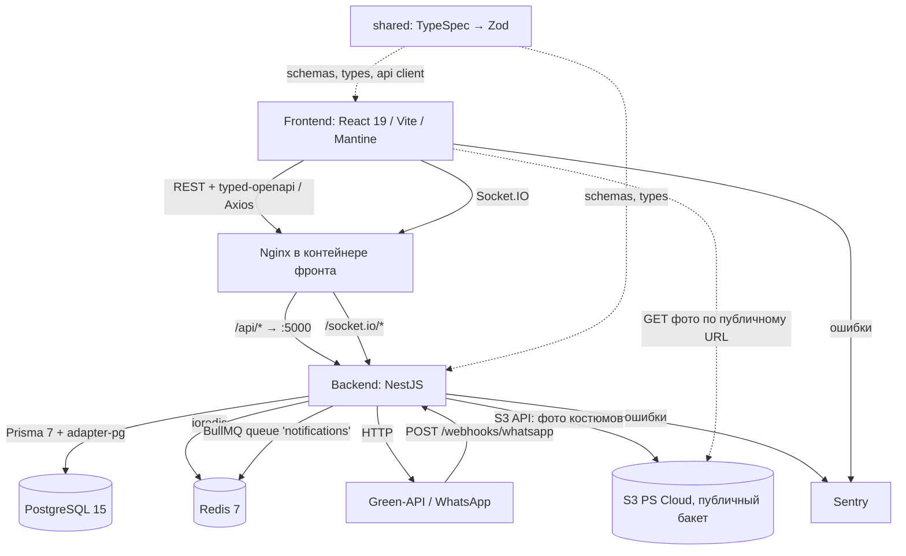

# Архитектура

## 1. Монорепозиторий

```
costumes/
├── apps/
│   ├── backend/          # NestJS API (@costumes/backend)
│   └── crm-frontend/     # React SPA (crm-frontend)
├── shared/               # Контракт API (@costumes/shared): TypeSpec → OpenAPI → Zod 4 + typed-openapi клиент
│   ├── api-spec/         # *.tsp — ЕДИНСТВЕННЫЙ источник истины для API
│   └── src/              # generated клиент/схемы + ручные экспорты схем/типов
├── .agents/              # правила и знания для AI-агентов
├── tasks/                # учёт задач: backlog/ · in-progress/ · done/
├── docker-compose.yaml   # прод-стек
├── docker-compose.dev.yml # локальные Postgres + Redis (см. setup.md)
├── nest-cli.json         # Nest monorepo-конфиг (проект `backend`)
└── tsconfig.base.json
```

Workspaces: `apps/*` и `shared`.

## 2. Схема



## 3. Компоненты

### shared (контракт)
TypeSpec (`shared/api-spec`) → `openapi.yaml` → `typed-openapi` → `shared/src/openapi-client.ts` (Zod 4 схемы + typed client). Frontend transport подключает клиент к Axios singleton и его interceptors. Поверх — ручные экспорты в `shared/src/{auth,children-client,costumes,visits-orders}.ts`. Подробно: [shared-api.md](./shared-api.md).

**Как пакеты потребляют shared:**
- **Backend** — через собранный `shared/dist` (`main: ./dist/index.js`, CommonJS). После правок shared нужен `build`.
- **Frontend** — напрямую из `shared/src` через path alias в `tsconfig.app.json` + `vite-tsconfig-paths`. Сборка shared фронту не нужна.

### backend (NestJS 12)
Модули: `auth`, `client-child`, `costumes`, `costume-photos`, `storage` (S3), `visit-order`, `notification`, `prisma`, `redis` (+ `queue.module`). Обычно слои Controller → Service → Prisma; в `notification` Prisma-выборки вынесены в узкий `NotificationRepository`. Глобально: `ZodValidationPipe`, `PrismaClientExceptionFilter`, `SentryInterceptor`, `IdempotencyInterceptor`, логгер Pino. Подробно: [backend.md](./backend.md).

### frontend (React 19 + Vite 8)
Feature-based структура (`features/{auth,clients-children,costumes,visits}`), Mantine 9, TanStack Query 5, Zustand 5, React Router 7, Socket.IO-клиент. Подробно: [frontend.md](./frontend.md).

### Redis — для чего используется
| Ключ | Назначение | TTL |
|---|---|---|
| `rf:{userId}` | refresh-токен пользователя | 7 дней |
| `idempotency:{userId}:{md5(url)}:{key}` | идемпотентность POST/PATCH/PUT по заголовку `X-Idempotency-Key` | 24 ч |
| `visit_code_lock:{code}` | резерв `visitCode` между «Проверить» и «Подтвердить» | 15 мин |
| `whatsapp:instance:{id}:status` / `:last_ts` | состояние WhatsApp-инстанса | без TTL |
| `whatsapp:availability:{sha256(phone)}` | результат `checkWhatsapp` (`exists`/`absent`), без номера в ключе | 1 час |
| `bull:notifications:*` | очередь BullMQ | управляет BullMQ |

### S3: фото костюмов
Хранилище — S3 PS Cloud (как в проекте secmarket), **публичный бакет** под костюмы. Бэкенд принимает фото `multipart` и сам кладёт их в S3 (`S3StorageService`, `@aws-sdk/client-s3`): прямая загрузка из браузера не проходила защиту провайдера. Браузер заранее сжимает фото (основное ~1600 px ≤ 2 МБ и превью ~320 px ≤ 200 КБ), поэтому запрос небольшой; nginx на `/api/` пропускает тело до `client_max_body_size 6m`.

- **Ключи:** `costumes/{costumeId}/{uuid}.{jpg|webp}` и `costumes/{costumeId}/{uuid}_thumb.{jpg|webp}`; uuid генерирует сервер, расширение — по реальной сигнатуре файла. Ключи хранятся в `CostumePhoto.key`/`thumbKey`, URL строится как `S3_PUBLIC_BASE_URL/<ключ>` и в БД не хранится.
- **Кэш:** объекты неизменяемы (новый uuid на каждое фото), поэтому `Cache-Control: public, max-age=31536000, immutable`.
- **Порядок записи:** сначала оба объекта в S3, затем запись в БД под блокировкой строки костюма (`SELECT … FOR UPDATE`: лимит 15 и `sortOrder` не ломаются при параллельной съёмке). Сбой БД или лимита — загруженные объекты удаляются. Удаление фото: `deletedAt`, затем удаление объектов из S3 (ошибка только логируется — в бакете остаётся лишний файл).
- **Env:** `S3_ENDPOINT`, `S3_REGION`, `S3_ACCESS_KEY`, `S3_SECRET_KEY`, `S3_BUCKET_PUBLIC`, `S3_PUBLIC_BASE_URL`, `S3_FORCE_PATH_STYLE` — таблица в [setup.md](./setup.md#2-переменные-окружения). Без настроенного S3 приложение стартует; фото-эндпоинты отвечают 503 «Хранилище фото не настроено», сбой S3 при загрузке — 502.
- **Тесты** реальный S3 не используют: `S3StorageService` подменён заглушкой в памяти (`t.s3` в `test/support/test-app.ts`).

### Аутентификация
- `POST /auth/login` → access token (JWT, 15 мин) в теле + refresh token (JWT, 7 дней) в httpOnly cookie `refreshToken`; refresh хранится в Redis и ротируется.
- Фронт хранит access token в Zustand (`persist` → localStorage `auth-storage`), подставляет `Authorization: Bearer`, на 401 вызывает `/auth/refresh` и повторяет запрос.
- WebSocket аутентифицируется токеном в `auth` handshake (`WsJwtGuard`).

## 4. Инфраструктура и деплой

**Прод** — один VPS, `docker-compose.yaml`: `postgres`, `redis`, `redis-insight`, `backend` (порт 5000 внутри сети), `frontend` (Nginx, 80/443, сертификаты из `./certs`). Домен `costumes.duckdns.org`. Nginx раздаёт SPA, проксирует `/api/` → `backend:5000/` (префикс `/api` срезается) и `/socket.io/`.

**CI/CD** — `.github/workflows/deploy.yaml`. На pull request в `main` и на push в `main` сначала job `check` (pnpm install --frozen-lockfile, сборка shared, `prisma generate`, typecheck backend и frontend, lint backend (`src/`) и frontend, `pnpm --filter @costumes/backend test`). Дальше — только на push в `main`:
1. `build-and-push`, `needs: check`: сборка и push образов `nailyn1/costumes-backend` и `nailyn1/costumes-frontend` в Docker Hub с двумя тегами: `<git SHA коммита>` и `latest`;
2. `deploy`: по SSH на сервере `git pull` → `export IMAGE_TAG=<SHA>` → `docker compose pull` → `up -d` → `prisma migrate deploy`.

Упавший `check` блокирует сборку и деплой. `main` = прод.

**Версии образов.** В `docker-compose.yaml` тег образов — `${IMAGE_TAG:-latest}`; деплой ставит `IMAGE_TAG` равным SHA пушнутого коммита, так что на сервере всегда запущена конкретная версия.

**Откат на предыдущий SHA** (SHA — из истории `main`/Actions; образ с этим тегом должен быть в Docker Hub). На сервере:

```bash
cd ~/costumes
export IMAGE_TAG=<sha предыдущего рабочего коммита>
docker compose pull backend frontend
docker compose up -d backend frontend
```

Миграции БД автоматически не откатываются: если откатываемая версия несовместима со схемой — решать с владельцем. Следующий успешный деплой снова выставит `IMAGE_TAG` на новый SHA. Если откат нужно закрепить — не мержить в `main` новые коммиты, пока не исправлено (или сделать `git revert`).

**Вне сезона сервер выключен.** Бэкапы: раньше cron на сервере ежедневно отправлял дамп БД в Telegram-чат; планируется перевод на S3 (задача [T-012](../tasks/backlog/T-012-bekapy-bd-v-s3.md)).

**Наблюдаемость:** Sentry (backend `@sentry/nestjs`, frontend `@sentry/react`, DSN из `SENTRY_DSN`), логи Pino → stdout + ротация файлов `logs/app.*.log` (7 дней).
