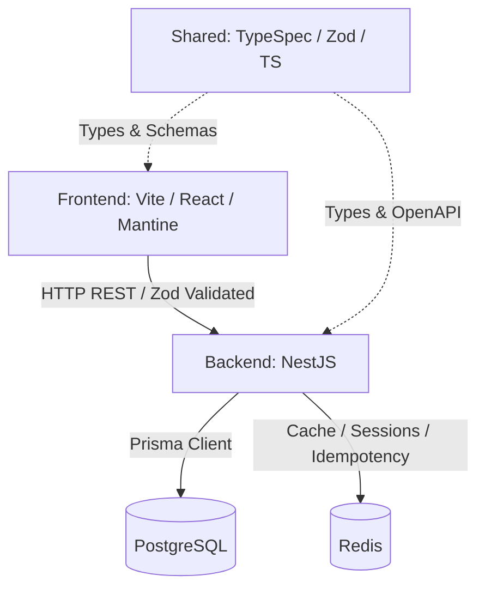

# Architecture: Costumes CRM

## 1. System Overview

Система представляет собой монорепозиторий (или логически связанный набор сервисов) для управления процессами аренды костюмов.
Она обеспечивает полный цикл работы: ведение базы клиентов, управление инвентарем (костюмами), оформление визитов и заказов, а также управление профилями детей и рассылку уведомлений.

## 2. High-Level Architecture Diagram

Система построена по классической клиент-серверной архитектуре со строго типизированным слоем контрактов.

## 3. Core Components

### 3.1. Shared (Contract Layer)

**Единый источник истины для API.**

- **Технологии:** TypeSpec, Zod.
- **Ответственность:** Описание эндпоинтов, генерация `openapi.yaml`, экспорт DTO (Data Transfer Objects) и схем валидации (Zod) для фронтенда и бэкенда.
- **Основные модули:** `auth`, `children`, `clients`, `costumes`, `visits`.

### 3.2. Backend (API Layer)

- **Технологии:** Node.js, TypeScript, NestJS, Prisma ORM.
- **Ответственность:** Бизнес-логика, авторизация, взаимодействие с БД, обработка HTTP-запросов.
- **Архитектурный паттерн:** Controllers -> Services.
  _Важно:_ Отдельный слой репозиториев отсутствует. Все прямые вызовы к базе данных (Prisma Client) осуществляются непосредственно внутри методов сервисов (Services).

### 3.3. Frontend (Presentation Layer)

- **Технологии:** Vite, React, TypeScript, Mantine (UI-kit).
- **Ответственность:** Рендеринг пользовательского интерфейса, управление состоянием и роутинг.
- **Стейт-менеджмент и данные:**
  - **Zustand:** для глобального клиентского состояния (UI-стейт, настройки).
  - **TanStack React Query:** для асинхронных запросов, кеширования и синхронизации серверных данных.
- **Связь с API:** Все запросы строго типизированы через DTO и схемы, импортируемые из пакета `shared`.

### 3.4. Infrastructure (Data Layer)

- **PostgreSQL:** Основное реляционное хранилище. Строгая нормализация таблиц.
- **Redis:** Используется для хранения сессий и обеспечения идемпотентности (idempotency) критически важных операций.
- **Docker:** Контейнеризация всех сервисов для унификации среды разработки и продакшена.

## 4. Key Data Models (Domain Entities)

Краткое описание главных сущностей для понимания бизнес-логики:

- **Client:** Взрослый клиент, который оплачивает аренду (содержит контактные данные, статус в черном списке и т.д.).
- **Child:** Ребенок клиента, для которого подбирается костюм. Жестко привязан к сущности `Client`.
- **Costume:** Единица инвентаря с историей статусов (доступен, в аренде, в чистке).
- **Order:** Сущность конкретной сделки (заказа). Связывает `Client`, `Child` и `Costume` на определенный период времени.
- **Visit:** Группирующая сущность, которая может содержать один или несколько `Order`. Служит для организации логики посещений и является триггером для последующей рассылки автоматических уведомлений (например, в WhatsApp).

## 5. Typical Data Flow (Пример: Создание Визита с Заказами)

1. **Frontend:** Пользователь заполняет форму создания визита. Данные валидируются локально с помощью Zod-схемы из `shared` (например, `CreateVisitRequestSchema`).
2. **Frontend (React Query):** Выполняет мутацию, отправляя HTTP POST запрос на бэкенд.
3. **Backend (Controller):** Получает запрос и валидирует payload (повторно используя ту же Zod-схему из `shared`).
4. **Backend (Service):** Проверяет бизнес-правила (например, доступны ли выбранные костюмы на указанные даты, проверка ключа идемпотентности в Redis).
5. **Backend (Prisma in Service):** Открывает транзакцию (`prisma.$transaction`), создает запись `Visit`, связанные с ней записи `Order`, и обновляет статусы для сущностей `Costume`.
6. **Backend:** Возвращает типизированный ответ на Frontend.
7. **Frontend:** React Query инвалидирует связанные кеши (например, список визитов), и UI автоматически обновляется.
