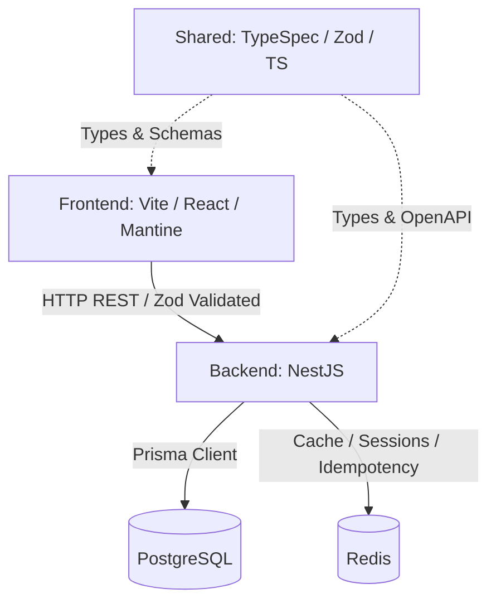

# AGENTS.MD / System Instructions for AI

**Project:** Costumes CRM (Full-Stack Monorepo)

## 1. System Overview & Architecture

Система представляет собой монорепозиторий (или логически связанный набор сервисов) для управления процессами аренды костюмов. Она обеспечивает полный цикл работы: ведение базы клиентов, управление инвентарем (костюмами), оформление визитов и заказов, а также управление профилями детей и рассылку уведомлений.

### High-Level Architecture Diagram



### Key Domain Entities

- **Client:** Взрослый клиент, оплачивающий аренду.
- **Child:** Ребенок клиента (жестко привязан к Client).
- **Costume:** Единица инвентаря с историей статусов.
- **Order:** Сущность сделки (связывает Client, Child и Costume на период).
- **Visit:** Группирующая сущность, содержащая один или несколько Order. Триггер для уведомлений.

---

## 2. CRITICAL WORKFLOW: Modifying API & Shared Types

**ВАЖНО:** Запрещено напрямую менять типы и контракты API в бэкенде или фронтенде. Любое изменение API ДОЛЖНО происходить через пакет `shared` по строгому алгоритму:

1. **Обнови TypeSpec файлы:** Внеси изменения в `.tsp` файлы в `shared/modules/` (`auth.tsp`, `children.tsp`, `clients.tsp`, `costumes.tsp`, `visits.tsp`).
2. **Сгенерируй OpenAPI:** Выполни `npm run gen:api` в папке `costumes/shared`.
3. **Экспортируй типы и схемы:** Вручную пропиши экспорт Zod-схемы и TS-типа в `shared/src/` (например, `costumes.ts`).
   ```typescript
   export type AddClientInBlackListRequestDto = z.infer<
     typeof schemas.Clients_blacklistReason
   >;
   export const CreateClientRequestSchema = schemas.Clients_CreateClientRequest;
   ```
4. **Собери пакет shared:** Выполни `npm run build` в папке `shared`, чтобы обновить `dist`.
   _Только после этого логику можно реализовывать в Backend/Frontend._

---

## 3. Backend Development Rules (NestJS)

### Architecture & Layers

- **Strict Layering (NestJS):** Приложение разделено на Controllers (роутинг/HTTP) и Services (бизнес-логика/БД). Отдельного слоя Data Access (репозиториев) НЕТ.
- **Controllers:** НИКАКОЙ бизнес-логики. Принимают запрос -> вызывают Service -> возвращают ответ.
- **Services:** Вся бизнес-логика и прямые вызовы к базе данных (Prisma Client) находятся здесь (`@Injectable()`).

### API & Validation

- **Shared Types:** ВСЕ Request/Response DTO импортируются ИСКЛЮЧИТЕЛЬНО из `shared/dist`.
- **Validation:** Входящие данные ВСЕГДА валидируются Zod-схемами из `shared`. Локальные интерфейсы запрещены.
- **Errors:** Перехватывай ошибки БД и возвращай HTTP-ответы (400, 404, 409).

### Database (Prisma)

- **No Raw SQL:** Всегда используй Prisma Client. `$queryRaw` — только для сверхсложной аналитики.
- **Transactions:** Для изменения нескольких таблиц ОБЯЗАТЕЛЬНО используй `prisma.$transaction`.
- **Soft Deletes:** Мы не удаляем записи физически! Только через `deletedAt`. При любых выборках (`findMany`, `findFirst`) всегда добавляй `where: { deletedAt: null }`.

### Redis & TypeScript

- **Redis:** Ключи должны иметь префикс домена (напр. `costumes_crm:session:{userId}`). Всегда ставь TTL (EX).
- **TS Rules:** `any` СТРОГО ЗАПРЕЩЕН. Используй `unknown` + type guards. Предпочитай `const` и функциональные методы (`.map`, `.filter`).

---

## 4. Frontend Development Rules (React + Vite)

### UI & Styling (Mantine)

- **Component Library:** Используем **Mantine** (`@mantine/core`, `@mantine/hooks`).
- **Styling:** Никаких `.css` файлов. Используй пропсы Mantine (`mt`, `p`, `bg`) и лэйауты `Box`/`Stack`/`Group`.
- **Icons:** `tabler-icons-react`.

### React Best Practices & State

- **Components:** Только функциональные компоненты и хуки.
- **Global State:** Для глобального UI/клиентского стейта используй **Zustand**.
- **Forms:** Для форм используй ТОЛЬКО `useForm` из `@mantine/form` + Zod-резолвер из `shared`.

### API & Fetching (Zodios + TanStack Query)

- **API Client:** Используй Zodios инстанс `apiClient` из `src/services/apiClient`.
  ```typescript
  export const costumeService = {
    createCostume(data: CreateCostumesRequestDto) {
      return apiClient.CostumeOperations_create(data);
    },
  };
  ```
- **React Query:** Для вызова сервисов используй TanStack React Query (`useQuery`, `useMutation`).
  ```typescript
  export function useCreateCostume() {
    const queryClient = useQueryClient();
    return useMutation({
      mutationFn: (data: CreateCostumesRequestDto) =>
        costumeService.createCostume(data),
      onSuccess: (newCostume) => {
        queryClient.invalidateQueries({ queryKey: costumesKeys.lists() });
        queryClient.setQueryData(
          costumesKeys.detail(newCostume.costumeId),
          newCostume,
        );
      },
    });
  }
  ```

### Project Structure (Feature-Based)

Строгая изоляция слоев. Бизнес-логику не писать в `/pages`!

- `/src/app` — Инициализация (QueryClient, `router.tsx`, `providers`).
- `/src/pages` — Экраны (только импорт фичей и UI).
- `/src/features` — Основные доменные модули (`auth`, `clients-children`, `costumes`, `notifications`, `visits`).
  - `.../components` — UI фичи (формы, модалки).
  - `.../hooks` — React Query (`useQuery`, `useMutation`).
  - `.../services` — API-вызовы фичи (через `apiClient`).
  - `.../types` — Локальные типы пропсов.
- `/src/components` — Глобальный UI (`MainLayout`, базовые кнопки).
- `/src/services` — Глобальные настройки (axios, zodios, interceptors, `socket.client.ts`).
- `/src/stores` — Zustand-сторы (напр. `auth.store.ts`).
- `/src/utils` — Утилиты (`handleError`, `formatters.ts`).

### TypeScript Strictness

- `any` СТРОГО ЗАПРЕЩЕН.
